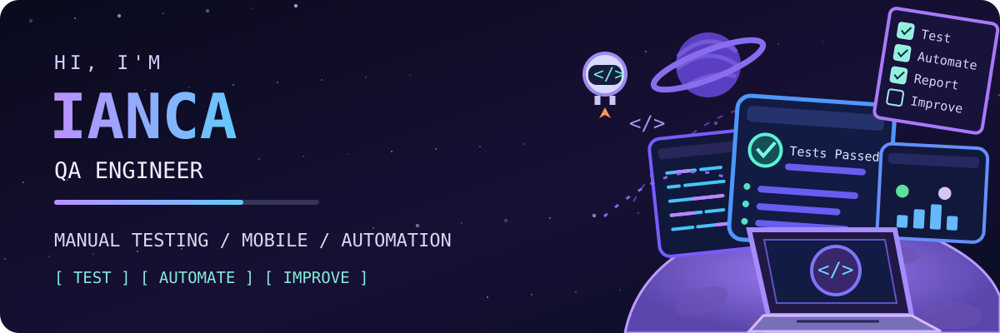

### 👩‍🚀 Olá, eu sou a Ianca! | Quality Assurance

**Testes manuais • Testes Mobile (Android & iOS) • Automação de testes • Qualidade de software**

---

## 🪐 Sobre mim

Sou estudante de Sistemas de Informação com foco em QA. Tenho explorado na prática conceitos de testes manuais e automatizados, buscando sempre enxergar a qualidade de forma completa: da execução dos testes à prevenção de problemas, da melhoria contínua à entrega de valor.

- 🧠 Estudante de QA com foco em fundamentos sólidos e aprendizado contínuo
- 📚 Estudo e prática de automação de testes com Selenium WebDriver + Python + Pytest
- 🧩 Conhecimento em testes manuais exploratórios e funcionais com base nos princípios fundamentais de teste
- 🔍 Foco em boas práticas de escrita de casos de teste, cenários e documentação clara
- 🛠️ Aprendizado constante sobre cobertura de testes, rastreabilidade e estratégia de QA
- 📎 Conhecimento introdutório em Jira
- 🚀 Desenvolvimento de projetos para portfólio com foco em testes E2E e geração de relatórios

---

## 🧰 Ferramentas e tecnologias

**Automação e programação**

**Testes de API e mobile**

**Gestão, documentação e colaboração**

---

## 🚀 Minha jornada em qualidade

`Planejar` → `Criar cenários` → `Executar testes` → `Reportar bugs` → `Automatizar` → `Melhorar`

---

### 📚 Meus Registros de Aprendizado e Projetos de Qualidade

[Documentação de Qualidade: User Stories na Prática](https://github.com/Ianca-del-cantone/user-story/blob/main/README.md#-documenta%C3%A7%C3%A3o-de-qualidade-user-stories-na-pr%C3%A1tica)

Documentação completa de user stories, com regras de negócio e critérios de aceite, que exemplifica como estruturar requisitos e testes na área de QA.

[Suíte de Testes na Prática - Adicionar itens à lista](https://github.com/Ianca-del-cantone/su-te-de-teste-adicionar-itens/blob/main/README.md)

Documentação de uma suíte de testes estruturada com Gherkin, voltada para validar a funcionalidade de adicionar itens a uma lista.
Inclui critérios de aceite, definição de prioridade e severidade, com foco na garantia da qualidade de software.

[Suíte de Testes na Prática - Validar filtro All"(Todos)"](https://github.com/Ianca-del-cantone/suite-de-testes-filtros/blob/main/README.md)

Documentação de testes com Gherkin para validar o comportamento do filtro "Todos (All)" na lista de tarefas da aplicação TodoMVC.
Inclui critérios de aceite e categorização por prioridade e severidade.

[Suíte de Testes na Prática - Validar filtro Active"(Ativos)"](https://github.com/Ianca-del-cantone/suite-de-teste-validar-filtro/blob/main/README.md)

Documentação de uma suíte de testes estruturada com Gherkin, voltada para validar o filtro "Active" na lista de tarefas da aplicação TodoMVC.
Inclui critérios de aceite, definição de prioridade e severidade, com foco na garantia da qualidade de software.

[Suíte de Testes na Prática - Validar filtro Completed"(Concluidos)"](https://github.com/Ianca-del-cantone/suite-de-teste-validar-filtro-completed/blob/main/README.md)

Esta suíte de testes foi elaborada utilizando a linguagem Gherkin para validar o comportamento do filtro "Completed" na aplicação TodoMVC.
A documentação contempla critérios de aceite, além da definição de prioridade e severidade de cada cenário, com foco em assegurar a qualidade da funcionalidade testada.

[Suíte de Testes na Prática - Validar filtro Clear Completed"(Limpar Tarefas Concluidas)"](https://github.com/Ianca-del-cantone/suite-de-teste-validar-filtro-clear-completed/blob/main/README.md)

Esta suíte de testes foi elaborada utilizando a linguagem Gherkin para validar o comportamento do filtro "Clear Completed" na aplicação TodoMVC.
A documentação contempla critérios de aceite, além da definição de prioridade e severidade de cada cenário, com foco em assegurar a qualidade da funcionalidade testada.

---

## 📊 Atividade no GitHub

---

### ✨ Quality is a journey, not a checkpoint.

*Obrigada por visitar meu perfil! Explore meus projetos e acompanhe minha evolução em QA.* 🦝🚀

